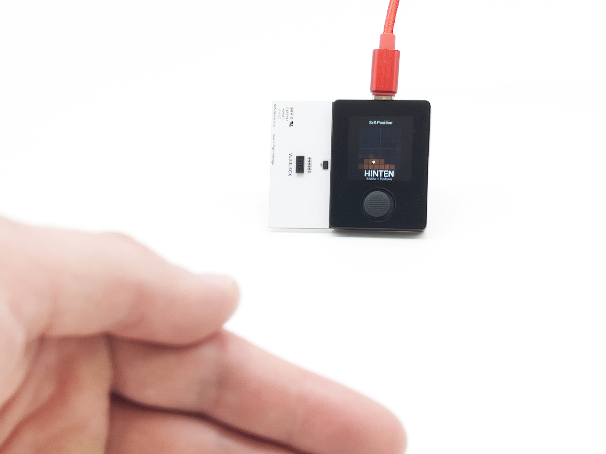

Maker Media GmbH

***

# Tiefenbilder mit der Oxocard

**Der Time-of-Flight-Sensor (ToF) ermöglicht es der Oxocard Connect, Objekte innerhalb seines Sichtfeldes anhand mehrerer Entfernungswerte räumlich zu erfassen. Damit lassen sich nicht nur Entfernungen messen, sondern auch Bewegungen erkennen, Gesten unterscheiden, zweidimensionale Darstellungen und sogar einfache 3D-Modelle erstellen.**

Hier findet ihr die Dateien für die im Artikel erwähnten Projekte.

Der vollständige Artikel zum Projekt steht in der **[Make-Ausgabe 7/26](https://www.heise.de/select/make/2026/7)**.
